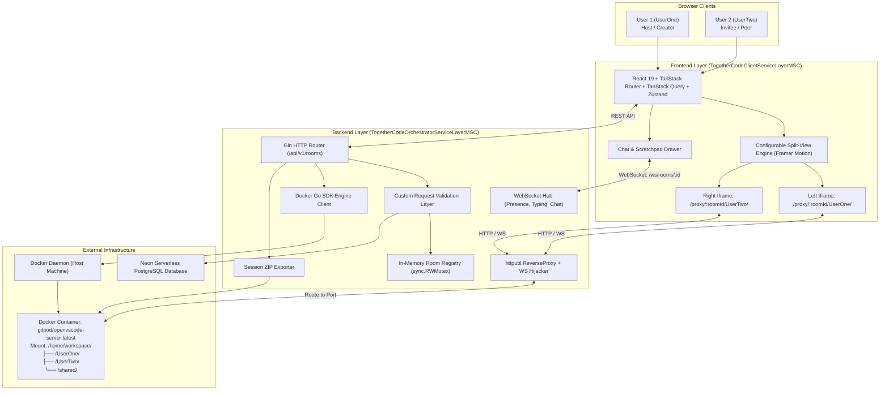
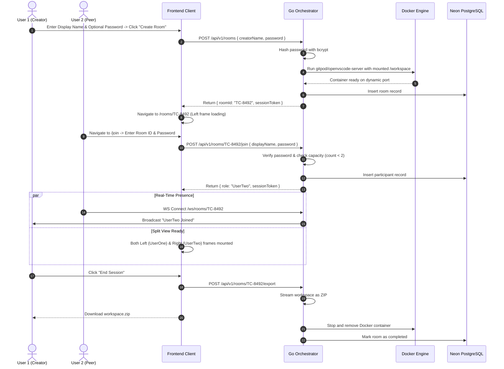

# TogetherCode — Architecture Specification Document

## 1. System Overview

**TogetherCode** is a real-time, 1:1 collaborative pairing platform that provides two peers with independent desktop-grade code editing environments while preserving mutual visibility and cross-editing capabilities. 

Each session features a dynamically configurable split-screen workspace where **User 1 (UserOne)** and **User 2 (UserTwo)** have dedicated workspaces, a fully featured in-browser editor powered by **OpenVSCode Server**, a live presence and avatar status layer, and a synchronized text chat and scratchpad drawer.

---

## 2. High-Level System Topology



---

## 3. Frontend Architecture (`TogetherCodeClientServiceLayerMSC`)

### 3.1 Technology Stack
* **Framework**: React (latest 19) + Vite + Strict TypeScript (zero `any`)
* **Routing**: TanStack Router (`@tanstack/react-router`) with type-safe routing
* **Server State & Data Fetching**: TanStack Query (`@tanstack/react-query`)
* **Client & UI State**: Zustand stores (`app/Stores/`)
* **Styling**: Tailwind CSS + Custom Design Tokens (strictly centralized)
* **Animation**: Framer Motion (drawer transitions, dynamic layout re-sizing)
* **Icons**: Lucide React
* **Validation & Forms**: Zod + React Hook Form (`@hookform/resolvers/zod`)

### 3.2 MSC (Model-Service-Controller) Pattern & Invariants
Adheres strictly to the architectural constraints established in `TogetherCodeClientServiceLayerMSC/CODING-RULES.md`:
1. **Zero-Assumption Protocol**: Whenever an architectural detail, style, or API specification is unstated, the assistant halts and asks the user directly.
2. **Explicit Typings**: All functional components explicitly declare `React.JSX.Element` as return type.
3. **Single Default Export**: Exactly one component per file, exported as `export default function ComponentName(): React.JSX.Element`.
4. **Universal PascalCase Mandate**: All directory names (`Src/`, `Routes/`, `Features/`, `Components/Static/`, `Components/Shared/`, `Constants/`, `Stores/`, `Helpers/`, `Utilities/`, `Types/`), file names, and component identifiers must be in PascalCase.
5. **Singleton Non-Components**: All helpers, services, and utilities are singleton classes:
   ```typescript
   export default class RoomService {
       public static current = new RoomService();
       public async getRoom(id: string): Promise<RoomModel> { ... }
   }
   ```
6. **No Hardcoded Values**:
   * Colors: Strictly sourced through `ColorFactoryCON.tsx` and dynamically driven by `ApplicationBaselineColorStateStore.ts`.
   * Spacing: All padding, margin, and gap values must come from `EdgeInsetsCON.tsx`.
   * Constants: All strings, route targets, and static arrays reside in `*CON.tsx` classes as `public static readonly`.
7. **Feature Topology (`Src/Features/${FolderName}/`)**:
   * `RootController.tsx`: High-level feature controller.
   * `Components/Static/`: Static sub-components private to this feature (`${FolderName}${ComponentName}StaticComponent.tsx`).
   * `Components/Shared/`: Components shared across features (`${FolderName}${ComponentName}SharedComponent.tsx`).
   * `Controllers/`: Component-level controllers (`${ComponentName}Controller.tsx`).
   * `Services/`: Feature service singletons (`${FeatureName}Service.ts`).
   * `Constants/`: Feature constants (`${FeatureName}CON.tsx`).
   * `Models/`: Data interfaces, enums, and Zod schemas (`${ModelName}Model.ts`).
8. **Global Types**: Placed in `Src/Types/` with separate files ending in `*Type.ts`.

---

## 4. Backend Architecture (`TogetherCodeOrchestratorServiceLayerMSC`)

### 4.1 Technology Stack
* **Language & Runtime**: Go (latest 1.23+)
* **HTTP Framework**: Gin (`github.com/gin-gonic/gin`)
* **Container Orchestration**: Official Docker Go SDK (`github.com/docker/docker/client`)
* **Reverse Proxy**: `net/http/httputil.ReverseProxy` with native WebSocket upgrade hijacking
* **Real-time Protocol**: WebSockets via `github.com/gorilla/websocket`
* **Database Driver**: `pgx` / `pgxpool` connecting to Neon Serverless PostgreSQL
* **Password Hashing**: `golang.org/x/crypto/bcrypt`
* **Compression**: `archive/zip` for room archive export

### 4.2 Core Subsystems

#### A. In-Memory Registry (`room.RoomManager`)
* Thread-safe in-memory map protected by `sync.RWMutex`.
* Tracks room ID, hashed password, active participant count, assigned container ID, internal port mapping, and last activity timestamp.
* Instant sub-millisecond lookup for reverse proxy routing.

#### B. Docker Container Manager (`container.DockerManager`)
* On room creation, spawns a single `gitpod/openvscode-server:latest` container:
  * Allocates a dynamic container port.
  * Creates an ephemeral workspace directory: `/tmp/togethercode/rooms/<roomId>/workspace/`.
  * Pre-populates starter files in `/UserOne/`, `/UserTwo/`, and `/shared/`.
  * Enforces CPU/RAM resource limits (e.g. 1.5GB RAM, 1.0 CPU quota).
* Enforces an idle cleanup loop: if 0 active connections persist for 10 minutes, the container is gracefully stopped and pruned.

#### C. Reverse Proxy & WebSocket Hijacker (`proxy.ReverseProxy`)
* Intercepts `/proxy/:roomId/*filepath`.
* Resolves the room's internal container port from the `RoomManager`.
* Re-writes the request URI and headers (`Upgrade: websocket`, `Connection: Upgrade`).
* Forwards bi-directional TCP/WebSocket streams for VS Code's Language Server Protocol (LSP), extensions, and terminal PTY.

#### D. Real-Time Hub (`ws.Hub`)
* Handles `/ws/rooms/:roomId` connections.
* Broadcasts participant presence (joined, left, typing, idle).
* Delivers instant text chat messages and shared scratchpad updates.
* Maintains heartbeat pings to detect abrupt disconnections.

#### E. Persistence Engine (`db.NeonRepository`)
* Asynchronously synchronizes room metadata, participant audit trails, chat logs, and session durations to Neon PostgreSQL.

---

## 5. OpenVSCode Server Workspace Layout

Inside the running Docker container:
```
/home/workspace/
├── README.md                          # Collaboration guidelines and session documentation
├── UserOne/                           # Primary workspace for Room Creator (User 1)
│   ├── main.py
│   ├── index.js
│   └── README.md
├── UserTwo/                           # Primary workspace for Invitee (User 2)
│   ├── main.py
│   ├── index.js
│   └── README.md
└── shared/                            # Shared directory for common assets & data files
    └── notes.txt
```

* **Left Iframe** loads: `http://localhost:8080/proxy/<roomId>/UserOne/?folder=/home/workspace/UserOne`
* **Right Iframe** loads: `http://localhost:8080/proxy/<roomId>/UserTwo/?folder=/home/workspace/UserTwo`
* Because both frames share the `/home/workspace` mount, both users can freely open, edit, compile, and run code in any folder across the workspace.

---

## 6. End-to-End User Journey



---

## 7. Security & Resilience Guardrails

1. **Strict 1:1 Access Guard**: A 3rd user attempting to join a room with 2 active peers is immediately rejected with HTTP 403 `ROOM_CAPACITY_EXCEEDED`.
2. **Password Protection**: Passwords hashed with bcrypt cost 12. No plaintext passwords stored in memory or DB.
3. **Session Token**: Authenticated peers receive a cryptographically signed session token stored in browser memory/sessionStorage to preserve session state on page refresh.
4. **Container Isolation**: Each room has an isolated container namespace with capped RAM (1.5GB) and CPU (1.0 core), preventing noisy-neighbor degradation.
5. **Inactivity Reaper**: A background Go goroutine runs every 60 seconds to detect rooms with zero active connections exceeding 10 minutes, automatically releasing system resources.
